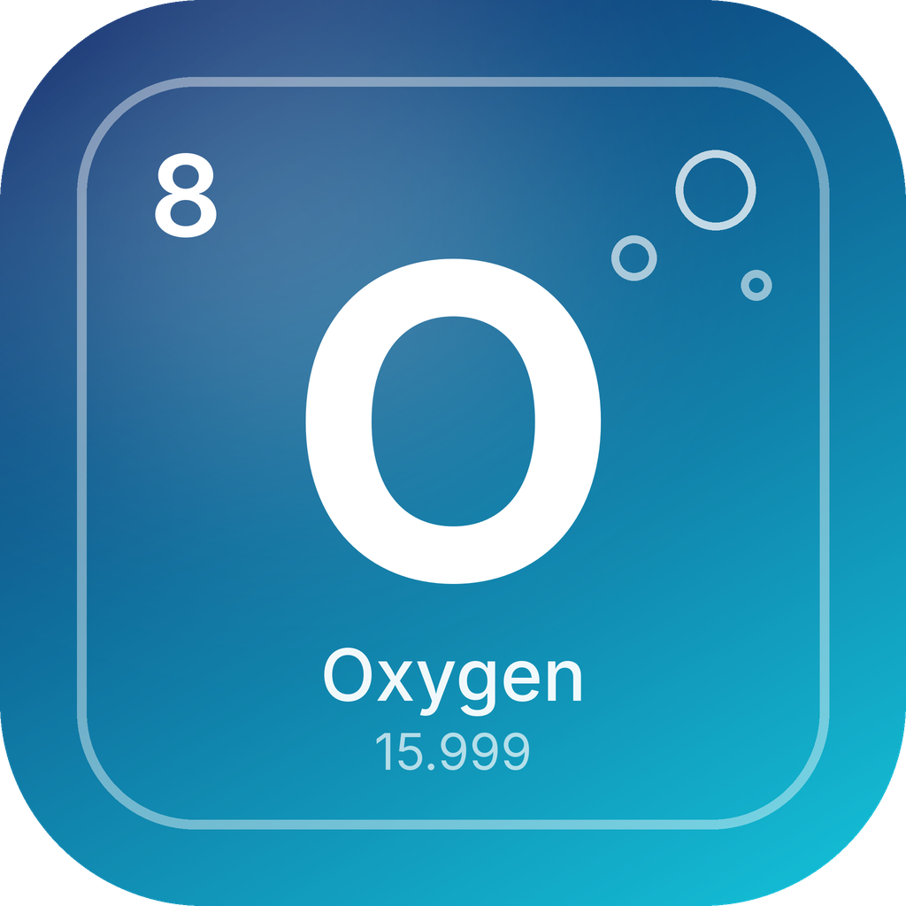

# oxygen

A lightweight browser with Zen-style features, for Windows and iOS, built to stay under 1 GB of RAM.

## Features

- Vertical tab sidebar with **Essentials** (shared across workspaces), pinned tabs and regular tabs
- **Workspaces**, each with its own icon and accent colour
- **Split view**: two tabs side by side
- **Compact mode**: hides the sidebar (on Windows it reappears when you hover the left edge)
- **Glance**: preview a link in a floating panel without opening a tab (Alt+click on Windows, long-press on iOS)
- Built-in ad and tracker blocking
- Session restore: tabs come back unloaded and only load when you open them

## How it stays under 1 GB

- It uses the engine your system already ships (WebView2 on Windows, WebKit on iOS) instead of bundling its own.
- All tabs share one engine instance.
- Background tabs are suspended right away, then unloaded after 10 minutes or once more than 4 tabs are loaded (3 on iOS).
- **Windows**: a watchdog measures the browser and every WebView2 process it starts every 3 seconds. Above the budget (800 MB by default), it unloads the least-recently-used background tabs. Current usage is shown at the bottom of the sidebar.
- **iOS**: iOS doesn't let apps measure web page processes, so the browser relies on the loaded-tab limit and also unloads background tabs when iOS sends a memory warning.

The budget, tab limit and idle time can all be changed in Settings. A single very heavy page that is on screen can still go over the budget on its own, because the watchdog never unloads tabs you're looking at.

## Downloads

Every push builds both apps with GitHub Actions. Download them from the **Actions** tab: open the latest **Build oxygen browser** run, then scroll to **Artifacts**.

### Windows

Download `oxygen-windows-x64` and run `oxygen.exe`. It needs the WebView2 Runtime, which comes with Windows 10 and 11.

| Shortcut | Action |
|---|---|
| Ctrl+T / Ctrl+L | New tab / address bar |
| Ctrl+W / Ctrl+Shift+T | Close / reopen tab |
| Ctrl+Tab, Ctrl+1–9 | Switch tabs |
| Ctrl+Alt+← / → | Switch workspace |
| Ctrl+Alt+V | Split view |
| Ctrl+Alt+C | Compact mode |
| Ctrl+Shift+E | Add to Essentials |
| Alt+click a link | Glance |
| F11 | Full screen |

Drag tabs to reorder them, or onto Essentials or the pinned area. Right-click a tab for more options.

Chrome extensions: put unpacked extensions in `%LOCALAPPDATA%\Oxygen\extensions\<name>\`.

### iOS (unsigned .ipa)

Download `oxygen-ios-unsigned` and install `oxygen.ipa` with [AltStore](https://altstore.io) or [Sideloadly](https://sideloadly.io), which sign it with your Apple ID. With a free Apple ID, the app has to be re-signed every 7 days.

## Building locally

- **Windows**: `cd desktop && cargo build --release`
- **iOS** (needs a Mac): `cd ios && xcodegen generate && open Oxygen.xcodeproj`
